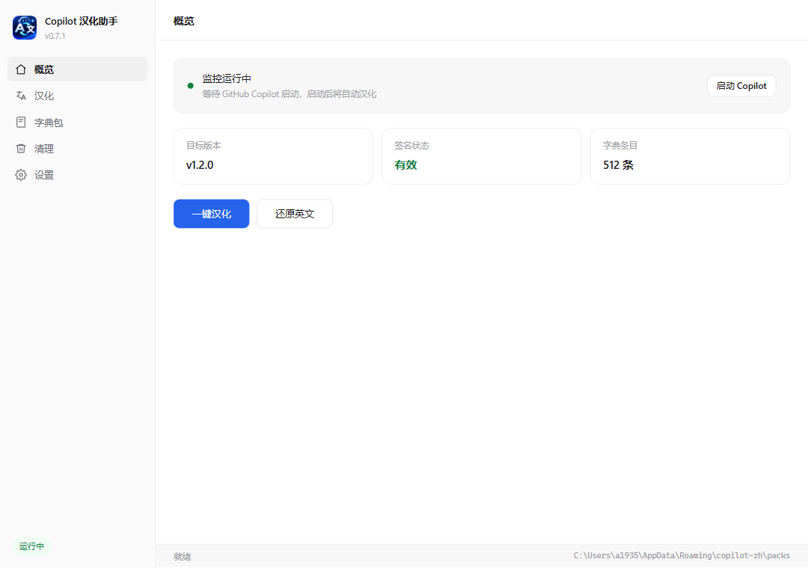

# Copilot Chinese Localization

[简体中文](README.md) ｜ **English**

[](https://www.microsoft.com/windows)
[](https://www.electronjs.org/)
[](LICENSE)
[](https://github.com/)

> A Windows tool that provides a **Simplified Chinese interface** for the **GitHub Copilot desktop app**.
> It does not modify the application itself, keeps its digital signature intact, and localizes automatically once configured.

---

## Overview

The GitHub Copilot desktop app (built with Tauri + WebView2) ships with no Chinese interface, no language packs, and no plugin mechanism — all UI strings are hard-coded into the application.

**Copilot Chinese Localization** connects to Copilot's rendering page through the WebView2 debugging port and injects translations into the DOM at runtime. As a result:

- **`github.exe` is never modified**, so Copilot's digital signature stays valid
- **Survives Copilot updates** — no need to re-patch
- **Applies automatically on startup** after a one-time setup

Translations are distributed as **independently signed dictionary packs**, decoupled from the application so they can be updated and rolled back separately.

<p align="center">
  
</p>

---

## Features

| Feature | Description |
| :--- | :--- |
| 🚀 **One-click localization** | Writes the debug policy, launches or restarts Copilot, waits for the UI, injects, and verifies |
| 🔄 **Resident auto-localization** | Injects automatically when Copilot starts or the page reloads |
| 🧩 **Dictionary/app separation** | Dictionary packs have independent versions and signatures, updatable without reinstalling |
| 🔐 **Signature verification** | Packs are signed with ed25519; tampered or mirror-poisoned packs are rejected |
| 🎯 **Never translates user content** | AI replies, code blocks, usernames, and session titles are excluded |
| 🕐 **Date localization** | `November 11, 2026, at 10:21 PM` → `2026年11月11日 22:21` |
| ♻️ **Clean revert** | Removes the debug policy and cleans up empty registry keys left behind |
| 🧹 **Zero-residue uninstall** | Removes app, data, policy, autostart entry, shortcuts, and update cache |
| 🖥️ **System tray** | Monitoring continues after the window is closed |
| 🔌 **Pluggable platforms** | Abstract engine interface; add a platform under `src/core/platform/<platform>` |

---

## Requirements

- **Windows 10 / 11** (x64)
- [GitHub Copilot desktop app](https://github.com/features/copilot) installed (tested with v1.3.0)
- WebView2 Runtime (bundled with Windows 11)
- **Administrator privileges** — writing the WebView2 debug policy requires HKLM access

---

## Installation

### Option 1: Installer (recommended)

1. Download the latest `CopilotHan-Setup-<version>.exe`
2. Run it and follow the wizard
3. Approve the UAC prompt when it appears

> **About UAC:** Localization requires writing an HKLM registry policy to enable the WebView2 debugging port. The executable manifest therefore declares `requireAdministrator`, so a UAC prompt appears on every launch.
>
> **About SmartScreen:** The installer is not code-signed, so Windows may show "Unknown publisher" on first run. Click "More info → Run anyway".

### Option 2: Run from source

```bash
git clone <repository-url>
cd copilot-zh
npm install
npm start
```

> **Note:** If the `ELECTRON_RUN_AS_NODE` environment variable is set, clear it first. Otherwise Electron is demoted to a plain Node process and cannot create a window.

---

## Usage

### Daily use (recommended)

Configure once, then forget about it:

1. Launch **Copilot Chinese Localization** as administrator
2. In **Settings**, enable **Launch at startup**
3. Use GitHub Copilot normally — it will be in Chinese

Closing the main window minimizes the app to the system tray; monitoring keeps running.

### First-time setup

1. Launch the app; it auto-detects Copilot's install path and version
2. Confirm a dictionary pack is loaded (bundled with the installer)
3. Click **Localize**

The app performs the full sequence automatically:

```
Write debug policy → Check port → Restart Copilot if needed → Launch
→ Wait for UI ready → Inject → Verify
```

If Copilot is already running without the debugging port enabled, the app restarts it for you — no manual closing required.

### Restoring English

Click **Restore English**. The app will:

1. Delete the WebView2 debug port policy value
2. Clean up the resulting empty registry keys (including parent keys)
3. Close Copilot automatically (enabled by default) so it starts in English

---

## Settings

| Setting | Default | Description |
| :--- | :---: | :--- |
| Launch Copilot after localizing | On | Start Copilot if it isn't running |
| Auto-restart Copilot to enable debug port | On | Restart Copilot when it runs without the port |
| Close Copilot when restoring English | On | A restart is required for English to take effect |
| Resident auto-localization | On | Inject when Copilot starts or the page reloads |
| Check interval | 1500 ms | Lower is more responsive, at slightly higher CPU cost |
| Launch at startup | Off | Writes an HKCU Run entry, removed on uninstall |
| Minimize to tray on close | On | Monitoring stops if disabled; keep enabled |

Settings are stored in `%APPDATA%\copilot-zh\settings.json` using atomic writes. Corrupted files are backed up and reset automatically.

---

## How It Works

The GitHub Copilot desktop app is built with **Tauri + WebView2**; its UI is a React application running inside WebView2.

```
┌──────────────────────────┐         ┌──────────────────────────┐
│  Copilot Localization    │         │  GitHub Copilot          │
│                          │         │                          │
│  ① Write WebView2 policy │────────▶│  ② WebView2 opens port   │
│  ③ Connect via CDP       │◀───────▶│  http://tauri.localhost  │
│  ④ Inject translator     │         │  ⑤ React renders Chinese │
│  ⑥ MutationObserver      │         │                          │
│     tracks re-renders    │         │                          │
└──────────────────────────┘         └──────────────────────────┘
```

**Key findings** (all empirically verified):

- Copilot v1.3.0 ignores the `WEBVIEW2_ADDITIONAL_BROWSER_ARGUMENTS` environment variable — a **registry policy is required**:
  ```
  HKLM\SOFTWARE\Policies\Microsoft\Edge\WebView2\AdditionalBrowserArguments
    github.exe = --remote-debugging-port=9222
  ```
- HKCU (user-level) policy has **no effect**; HKLM is required, hence administrator privileges
- The policy only takes effect after **restarting Copilot**
- The app renders a loading skeleton first, so injection must wait for the real UI or the translation is overwritten

---

## Dictionary Packs

### Structure

```
zh-CN-1.6.0/
├── manifest.json         ed25519 signature + payload hash
└── zh-CN-1.6.0.json      translation content
```

`manifest.json`:

```json
{
  "manifest": {
    "packVersion": "1.6.0",
    "locale": "zh-CN",
    "appCompat": { "min": "1.0.0", "max": null },
    "entryCounts": { "texts": 1110, "patterns": 84, "attrs": 28, "attrPatterns": 39 },
    "payload": { "name": "zh-CN-1.6.0.json", "size": 72505, "sha256": "..." }
  },
  "signature": "<base64>",
  "pubkey": "<PEM>"
}
```

Payload:

```json
{
  "schema": 1,
  "locale": "zh-CN",
  "entries": {
    "texts":        { "Sidebar": "侧边栏" },
    "patterns":     [["^(\\d+)% used$", "$1% 已使用", ""]],
    "attrs":        { "Resize sidebar": "调整侧边栏大小" },
    "attrPatterns": [["^Search (\\d+) skills…$", "搜索 $1 个技能…", ""]]
  }
}
```

Four matching strategies:

| Type | Purpose |
| :--- | :--- |
| `texts` | Exact match on visible text and `aria-label` |
| `patterns` | Regex for dynamic strings (numbers, dates) |
| `attrs` | Exact match on `placeholder` / `title` / `aria-label` / `alt` |
| `attrPatterns` | Regex on attribute values |

### Current coverage

- **1110** exact text entries
- **84** text regex rules
- **28** attribute mappings
- **39** attribute regex rules

Full UI sweep against Copilot v1.3.0 (main window, sidebar pages, all settings tabs, user menu, command palette, announcements, About): every UI string is localized except theme/palette names, brand names, shortcuts and code identifiers.

### Building a pack

```bash
node scripts/build-pack.js --version 1.6.0
```

The script reads `src/core/dict/translations.json` (a topic-grouped word list), expands it into the runtime structure, signs it, and writes to `dist-packs/`.

On first run, a signing key is generated at `build/pack-signing-key.pem`. **Keep this file safe** — all subsequent packs should be signed with the same key, otherwise the trust relationship with clients must be re-established.

---

## Development

### Project structure

```
copilot-zh/
├── electron/
│   ├── main.js                Main process: window, tray, IPC, orchestration
│   └── preload.js             Preload: whitelisted API exposure
├── src/
│   ├── core/
│   │   ├── applyFlow.js       One-click localization orchestration
│   │   ├── locator.js         Locate Copilot (registry + common paths, cached)
│   │   ├── settings.js        Settings persistence (atomic, self-healing)
│   │   ├── watcher.js         Resident monitor (polling, auto-inject, state tracking)
│   │   ├── autostart.js       Launch at startup (HKCU Run key)
│   │   ├── cleanup.js         Residue audit & cleanup (single registry of traces)
│   │   ├── delayedDelete.js   Deferred deletion after exit (file-lock fix)
│   │   ├── platform/
│   │   │   ├── engine.js      Engine interface contract + platform registry
│   │   │   └── win32/
│   │   │       ├── index.js           Windows platform registration
│   │   │       └── runtimeInject.js   Mode A: CDP runtime injection
│   │   └── dict/
│   │       ├── pack.js        Pack loading, verification, compatibility, building
│   │       └── translations.json  Translation word list (topic-grouped)
│   └── ui/                    Interface (vanilla HTML/CSS/JS, no framework)
├── build/
│   ├── icon.ico               Application icon
│   └── installer.nsh          Custom NSIS uninstall script
└── scripts/                   Build and test tooling
```

### Commands

```bash
npm start                  # Run in development mode
npm run build              # Build NSIS installer (output in dist/)
node scripts/build-pack.js # Build a dictionary pack
node scripts/test-ui.js    # UI regression tests
node scripts/test-apply.js # End-to-end localization test
```

### Test scripts

| Script | Purpose |
| :--- | :--- |
| `test-apply.js` | End-to-end localization (cold start / already running) |
| `test-revert.js` | Revert thoroughness and auto-close behavior |
| `test-paged-ui.js` | Page navigation, custom select, switches |
| `test-delayed-delete.js` | Deferred deletion (simulated file lock) |
| `verify-settings.js` | Traverse screens and measure coverage |
| `verify-revert.js` | Registry residue check after revert |

### Adding a platform

The engine contract lives in `src/core/platform/engine.js`. Implement these methods:

```javascript
class MyEngine extends I18nEngine {
  get id() { return 'my-engine'; }
  get displayName() { return 'My Engine'; }
  capabilities() { /* declare whether it modifies the app, breaks signatures, etc. */ }
  async probe(target) { /* check compatibility */ }
  async apply(target, dict, opts) { /* perform localization */ }
  async revert(target) { /* restore */ }
  async status(target) { /* query state */ }
}
```

Then register it in `src/core/platform/<platform>/index.js` — no changes to core code required.

---

## Data Locations

| Path | Contents |
| :--- | :--- |
| `%LOCALAPPDATA%\Programs\CopilotHan` | Application files |
| `%APPDATA%\copilot-zh\packs` | Dictionary packs |
| `%APPDATA%\copilot-zh\settings.json` | User settings |
| `%APPDATA%\copilot-zh\logs` | Logs |
| `%APPDATA%\copilot-zh\backups` | Executable backups (reserved for Mode B) |

Application and data are physically separated: updating dictionaries doesn't affect the app, and updating the app doesn't lose dictionaries.

> The data directory is fixed as `copilot-zh`, decoupled from the display name. Renaming the product will not make existing users' data "disappear".

---

## Uninstall & Cleanup

### Uninstall

Use "Settings → Apps → Installed apps" or the Start menu uninstaller. It will:

1. Force-terminate all related processes (even if running or hidden in the tray)
2. Delete application files
3. Delete user data and update cache
4. Remove the WebView2 debug policy (including empty keys)
5. Remove the autostart entry, shortcuts, and uninstall registry entry

### In-app cleanup

The **Cleanup** page provides residue auditing and one-click cleanup:

- Scans and lists all known traces
- Directories locked by the running app are scheduled for deletion after exit (avoiding `EBUSY`)
- Offers to quit immediately after cleanup to finish the last step

---

## Security Notes

- Debug port `9222` **listens on `127.0.0.1` only** and does not accept external connections
- However, other local programs could theoretically connect to that port and control the Copilot page
- When not localizing, consider clicking **Restore English** to remove the debug policy
- The tool collects no user data, transmits nothing, and makes no network requests (except dictionary update checks)

---

## Known Limitations

- Verified only on Windows 10/11 (Copilot v1.3.0)
- Dictionary coverage is limited; unlisted strings remain in English
- Prompt text auto-filled into the composer stays in English: the editor is intentionally left untouched so what you send to Copilot is never altered
- Text inside icons and images cannot be translated
- AI replies, code blocks, usernames, and session titles are intentionally not translated
- The installer is not code-signed; SmartScreen may warn on first run
- Administrator privileges are required, so UAC prompts on every launch

---

## Contributing

Issues and pull requests are welcome.

**Adding translations** is the easiest way to contribute:

1. Edit `src/core/dict/translations.json` and add `"English": "中文"` under an existing group
2. Run `node scripts/build-pack.js --version <new-version>` to generate a pack
3. In your PR, describe the number of entries added and which screens they cover

When reporting untranslated strings, please provide the **exact English text** rather than a screenshot — it makes matching precise.

---

## Disclaimer

This is an **unofficial community tool**, not affiliated with GitHub.

Using this tool may violate the GitHub Copilot Terms of Service. Evaluate the risks yourself. The author assumes no responsibility for any issues arising from its use.

Please comply with the laws of your jurisdiction and applicable software licenses.

---

## License

[MIT](LICENSE)

---

<p align="center">
  <sub>If this tool helps you, consider giving it a Star ⭐</sub>
</p>
