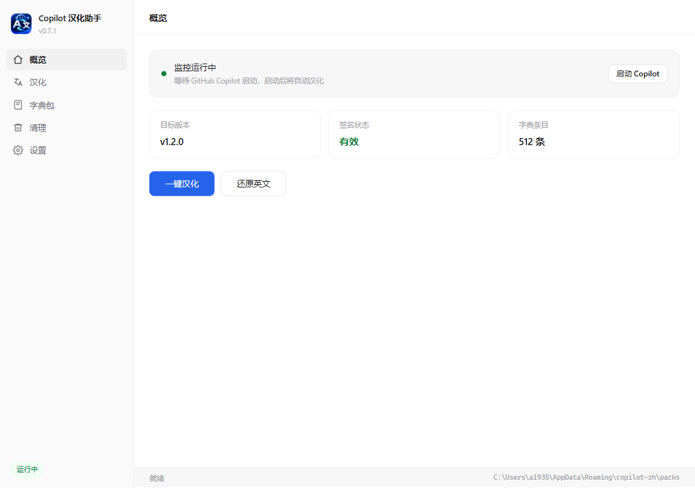

# Copilot 汉化助手

**简体中文** ｜ [English](README.en.md)

[](https://www.microsoft.com/windows)
[](https://www.electronjs.org/)
[](LICENSE)
[](https://github.com/)

> 为 **GitHub Copilot 桌面版** 提供简体中文界面的 Windows 工具。
> 不修改应用本体，数字签名保持完好，一次配置后随 Copilot 启动自动汉化。

---

## 简介

GitHub Copilot 桌面版（Tauri + WebView2 架构）目前没有内置中文界面，也没有语言包或插件机制——界面文案全部硬编码在应用内。

**Copilot 汉化助手** 通过 WebView2 调试端口连接 Copilot 的渲染页面，把翻译实时注入到 DOM 中。整个过程：

- **不改动 `github.exe`**，Copilot 的数字签名保持有效
- **Copilot 升级后依然可用**，无需重新打补丁
- **随启动自动生效**，配置一次后无需再手动操作

汉化内容以**独立签名的字典包**形式分发，与软件本体分离，可单独更新和回滚。

<p align="center">
  
</p>

---

## 特性

| 特性 | 说明 |
| :--- | :--- |
| 🚀 **一键汉化** | 自动写入调试策略、启动或重启 Copilot、等待界面就绪、注入并验证 |
| 🔄 **常驻自动汉化** | Copilot 启动或页面刷新时自动注入，无需手动操作 |
| 🧩 **字典与软件分离** | 字典包独立版本、独立签名，可单独更新而不重装软件 |
| 🔐 **签名校验** | 字典包使用 ed25519 签名，篡改或镜像投毒会被拒绝安装 |
| 🎯 **不误翻用户内容** | AI 回复、代码块、用户名、会话标题不会被翻译 |
| 🕐 **日期本地化** | `November 11, 2026, at 10:21 PM` → `2026年11月11日 22:21` |
| ♻️ **彻底还原** | 移除调试策略并清理空注册表键，不残留任何本工具创建的键 |
| 🧹 **卸载零残留** | 程序、数据、策略、自启项、快捷方式、更新缓存全部清除 |
| 🖥️ **托盘常驻** | 关闭窗口后监控继续运行 |
| 🔌 **平台可插拔** | 引擎接口抽象，新增平台只需实现 `src/core/platform/<平台>` |

---

## 系统要求

- **Windows 10 / 11**（x64）
- [GitHub Copilot 桌面版](https://github.com/features/copilot) 已安装（测试版本 v1.3.0）
- WebView2 Runtime（Windows 11 已内置）
- **管理员权限**：写入 WebView2 调试策略需要 HKLM 权限

---

## 安装

### 方式一：安装包（推荐）

1. 下载最新的 `CopilotHan-Setup-<版本号>.exe`
2. 双击运行，按向导完成安装
3. 程序会请求管理员权限（UAC 提示点是）

> **关于 UAC 提示**：汉化需要写 HKLM 注册表策略开启 WebView2 调试端口，因此程序清单声明了 `requireAdministrator`，每次启动会弹 UAC 确认，这是正常现象。
>
> **关于 SmartScreen**：安装包未购买代码签名证书，首次运行可能提示"未知发布者"，点击"更多信息 → 仍要运行"即可。

### 方式二：从源码运行

```bash
git clone <仓库地址>
cd copilot-zh
npm install
npm start
```

> **注意**：若环境中存在 `ELECTRON_RUN_AS_NODE` 环境变量，需先清除，否则 Electron 会被降级为纯 Node 进程而无法创建窗口。

---

## 使用

### 日常使用（推荐）

配置一次后无需再管：

1. 以管理员身份启动「Copilot 汉化助手」
2. 在 **设置** 中开启「开机自动启动」
3. 正常使用 GitHub Copilot —— 它会自动变成中文界面

关闭主窗口会最小化到系统托盘，常驻监控继续工作。

### 首次配置

1. 启动程序，程序会自动检测 Copilot 的安装路径与版本
2. 确认字典包已加载（安装包已内置）
3. 点击 **一键汉化**

程序会自动完成以下步骤：

```
写入调试策略 → 检测端口 → 必要时重启 Copilot → 启动 → 等待界面就绪 → 注入 → 验证
```

如果 Copilot 正在运行但调试端口尚未开启，程序会自动重启它——你不需要手动关闭 Copilot。

### 还原英文

点击 **还原英文**，程序会：

1. 删除 WebView2 调试端口策略值
2. 清理因此产生的空注册表键（含父键）
3. 按设置自动关闭 Copilot（默认开启），确保重新打开时显示英文

---

## 设置项

| 设置 | 默认 | 说明 |
| :--- | :---: | :--- |
| 汉化后同步启动 GitHub Copilot | 开启 | 汉化成功后若 Copilot 未运行则自动启动 |
| 自动重启 Copilot 以启用调试端口 | 开启 | Copilot 在运行但端口未开时自动重启它 |
| 还原英文时自动关闭 Copilot | 开启 | 还原后需重启 Copilot 才显示英文，自动关闭更省事 |
| 常驻监控自动汉化 | 开启 | Copilot 启动或页面刷新时自动注入 |
| 检查间隔 | 1500 ms | 越小越灵敏，CPU 开销略高 |
| 开机自动启动 | 关闭 | 写入 HKCU Run 键，卸载时自动清除 |
| 关闭窗口时最小化到托盘 | 开启 | 关闭后常驻监控会停止，建议保持开启 |

设置保存在 `%APPDATA%\copilot-zh\settings.json`，采用原子写入，文件损坏会自动备份并重置。

---

## 工作原理

GitHub Copilot 桌面版使用 **Tauri + WebView2** 构建，界面是运行在 WebView2 中的 React 应用。

```
┌─────────────────────────┐         ┌──────────────────────────┐
│  Copilot 汉化助手        │         │  GitHub Copilot          │
│                         │         │                          │
│  ① 写 WebView2 策略     │────────▶│  ② WebView2 开启调试端口   │
│  ③ 通过 CDP 连接页面    │◀───────▶│  http://tauri.localhost  │
│  ④ 注入翻译脚本         │         │  ⑤ React 渲染时应用翻译    │
│  ⑥ MutationObserver     │         │                          │
│     跟踪重渲染           │         │                          │
└─────────────────────────┘         └──────────────────────────┘
```

**关键技术点**（均为实测结论）：

- Copilot v1.3.0 会忽略环境变量 `WEBVIEW2_ADDITIONAL_BROWSER_ARGUMENTS`，**必须写注册表策略**：
  ```
  HKLM\SOFTWARE\Policies\Microsoft\Edge\WebView2\AdditionalBrowserArguments
    github.exe = --remote-debugging-port=9222
  ```
- HKCU（用户级）策略**无效**，必须 HKLM，因此需要管理员权限
- 策略写入后需**重启 Copilot** 才生效
- 应用刚启动时会先渲染加载骨架，必须等真实界面出现再注入，否则翻译会被骨架覆盖

---

## 字典包

### 结构

```
zh-CN-1.6.0/
├── manifest.json         含 ed25519 签名与载荷哈希
└── zh-CN-1.6.0.json      翻译内容
```

`manifest.json`：

```json
{
  "manifest": {
    "packVersion": "1.6.0",
    "locale": "zh-CN",
    "appCompat": { "min": "1.0.0", "max": null },
    "entryCounts": { "texts": 935, "patterns": 56, "attrs": 28, "attrPatterns": 37 },
    "payload": { "name": "zh-CN-1.6.0.json", "size": 62335, "sha256": "..." }
  },
  "signature": "<base64>",
  "pubkey": "<PEM>"
}
```

载荷内容：

```json
{
  "schema": 1,
  "locale": "zh-CN",
  "entries": {
    "texts":        { "Sidebar": "侧边栏" },
    "patterns":     [["^(\\d+)% used$", "$1% 已使用", ""]],
    "attrs":        { "Resize sidebar": "调整侧边栏大小" },
    "attrPatterns": [["^Search (\\d+) skills…$", "搜索 $1 个技能…", ""]]
  }
}
```

四种匹配方式：

| 类型 | 用途 |
| :--- | :--- |
| `texts` | 精确匹配可见文本与 `aria-label` |
| `patterns` | 正则匹配动态文案（带数字、时间的句子） |
| `attrs` | 精确匹配 `placeholder` / `title` / `aria-label` / `alt` |
| `attrPatterns` | 正则匹配属性值 |

替换串里可用 `{{n}}` 引用第 n 个捕获组，并自动再查一次 `texts` 词典。用于组合型文案：

```json
["^Edit shortcut for (.+)$", "编辑「{{1}}」的快捷键", ""]
```

`Edit shortcut for New tab` → `编辑「新建标签页」的快捷键`（`New tab` 由 `texts` 提供译文）。

### 当前覆盖

- **935** 条精确文本
- **56** 条文本正则
- **28** 条属性映射
- **37** 条属性正则

基于 Copilot v1.3.0 的全量界面巡检（主界面、侧边栏各页、设置全部子页、用户菜单、命令面板、公告面板、关于页），除主题/调色板名称、品牌名、快捷键与代码标识符外，界面文案已全部中文化。

### 构建字典包

```bash
node scripts/build-pack.js --version 1.6.0
```

该脚本读取 `src/core/dict/translations.json`（按主题分组的词库），展开为运行时结构并签名输出到 `dist-packs/`。

首次运行时若无签名密钥，会自动生成 `build/pack-signing-key.pem`。**请妥善保管此文件**，后续所有字典包应使用同一密钥签名，否则用户端的信任关系需要重新建立。

---

## 开发

### 项目结构

```
copilot-zh/
├── electron/
│   ├── main.js                主进程：窗口、托盘、IPC、业务编排
│   └── preload.js             预加载：白名单方式暴露 API
├── src/
│   ├── core/
│   │   ├── applyFlow.js       一键汉化完整闭环编排
│   │   ├── locator.js         定位 Copilot（注册表 + 常见路径，带缓存）
│   │   ├── settings.js        设置持久化（原子写入 + 损坏自愈）
│   │   ├── watcher.js         常驻监控（轮询 + 自动注入 + 状态追踪）
│   │   ├── autostart.js       开机自启（HKCU Run 键）
│   │   ├── cleanup.js         残留审计与清理（痕迹统一登记处）
│   │   ├── delayedDelete.js   退出后延迟删除（解决文件占用）
│   │   ├── platform/
│   │   │   ├── engine.js      引擎接口契约 + 平台注册表
│   │   │   └── win32/
│   │   │       ├── index.js           Windows 平台注册
│   │   │       └── runtimeInject.js   模式 A：CDP 运行时注入
│   │   └── dict/
│   │       ├── pack.js        字典包加载、验签、兼容性检查、打包
│   │       └── translations.json  翻译词库（按主题分组）
│   └── ui/                    界面（原生 HTML/CSS/JS，无框架）
├── build/
│   ├── icon.ico               应用图标
│   └── installer.nsh          NSIS 自定义卸载脚本
└── scripts/                   构建与测试工具
```

### 常用命令

```bash
npm start                  # 开发模式运行
npm run build              # 构建 NSIS 安装包（输出到 dist/）
node scripts/build-pack.js # 构建字典包
node scripts/test-ui.js    # UI 回归测试
node scripts/test-apply.js # 一键汉化端到端测试
```

### 测试脚本

| 脚本 | 用途 |
| :--- | :--- |
| `test-apply.js` | 一键汉化端到端测试（冷启动 / 已运行两种场景） |
| `test-revert.js` | 还原英文彻底性与自动关闭 Copilot |
| `test-paged-ui.js` | 分页导航、自定义下拉框、开关控件 |
| `test-delayed-delete.js` | 延迟删除机制（模拟文件占用） |
| `verify-settings.js` | 遍历各界面统计汉化覆盖率 |
| `verify-revert.js` | 还原后注册表残留检查 |

### 扩展新平台

引擎接口定义在 `src/core/platform/engine.js`，实现以下方法即可接入新平台：

```javascript
class MyEngine extends I18nEngine {
  get id() { return 'my-engine'; }
  get displayName() { return '我的引擎'; }
  capabilities() { /* 声明是否改本体、破签名、需常驻等 */ }
  async probe(target) { /* 探测兼容性 */ }
  async apply(target, dict, opts) { /* 执行汉化 */ }
  async revert(target) { /* 还原 */ }
  async status(target) { /* 查询状态 */ }
}
```

然后在 `src/core/platform/<平台>/index.js` 中注册，核心代码无需改动。

---

## 数据存储

| 位置 | 内容 |
| :--- | :--- |
| `%LOCALAPPDATA%\Programs\CopilotHan` | 程序文件 |
| `%APPDATA%\copilot-zh\packs` | 字典包 |
| `%APPDATA%\copilot-zh\settings.json` | 用户设置 |
| `%APPDATA%\copilot-zh\logs` | 日志 |
| `%APPDATA%\copilot-zh\backups` | exe 备份（模式 B 预留） |

软件与数据物理分离：更新字典不影响软件，更新软件不丢失字典。

> 数据目录名固定为 `copilot-zh`，与产品显示名解耦。这样产品改名不会导致老用户的数据"消失"。

---

## 卸载与清理

### 卸载

通过「设置 → 应用 → 已安装的应用」或开始菜单中的卸载程序卸载。卸载器会：

1. 强制结束所有相关进程（即使程序正在运行或隐藏在托盘）
2. 删除程序文件
3. 删除用户数据、更新缓存
4. 清理 WebView2 调试策略（含空键）
5. 清理开机自启项、快捷方式、卸载注册项

### 程序内彻底清理

**清理** 页面提供残留审计与一键清理：

- 自动扫描并列出所有已知痕迹
- 被程序自身占用的目录会安排退出后删除（避免 `EBUSY`）
- 清理完成后可选择立即退出以完成最后一步

---

## 安全说明

- 调试端口 `9222` **仅监听 `127.0.0.1`**，不接受外部连接
- 但同机上的其他程序理论上可连接该端口并操控 Copilot 页面
- 不使用汉化时，建议点击 **还原英文** 移除调试策略
- 本工具不收集、不传输任何用户数据，不联网（除检查字典更新外）

---

## 已知限制

- 仅在 Windows 10/11 上验证（Copilot v1.3.0）
- 字典覆盖有限，未收录的文案保持英文
- 输入框内自动填入的提示词保持英文：为避免改动将要发送给 Copilot 的内容，编辑区不做翻译
- 图标与图片内的文字无法翻译
- AI 回复、代码块、用户名、会话标题不会被翻译（有意为之）
- 安装包未做代码签名，首次运行会有 SmartScreen 提示
- 需要管理员权限，每次启动会弹 UAC

---

## 贡献

欢迎提交 Issue 与 Pull Request。

**补充翻译**是最容易参与的贡献方式：

1. 编辑 `src/core/dict/translations.json`，按现有分组添加 `"英文": "中文"`
2. 运行 `node scripts/build-pack.js --version <新版本号>` 生成字典包
3. 提交 PR 时说明新增条目数量与覆盖的界面

发现未翻译的文案时，请在 Issue 中提供**英文原文**（而非截图），这样更便于精确匹配。

---

## 免责声明

本项目是**非官方社区工具**，与 GitHub 公司无关。

使用本工具可能违反 GitHub Copilot 服务条款，请自行评估风险。因使用本工具产生的任何问题，作者不承担责任。

请遵守所在地区的法律法规与软件许可协议。

---

## 许可证

[MIT](LICENSE)

---

<p align="center">
  <sub>如果这个工具对你有帮助，欢迎 Star ⭐</sub>
</p>
